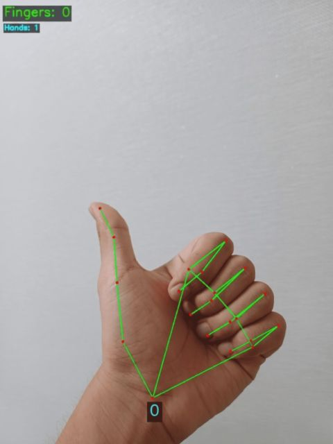
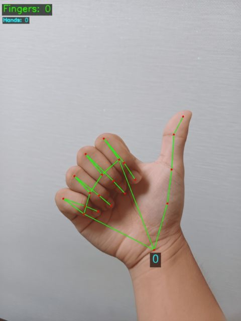
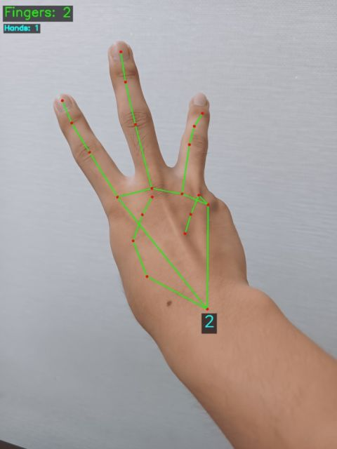
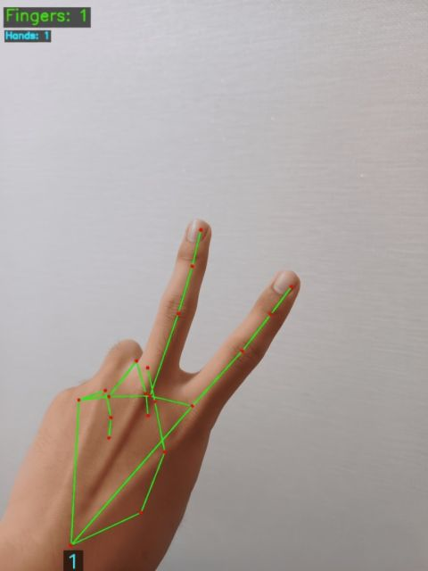
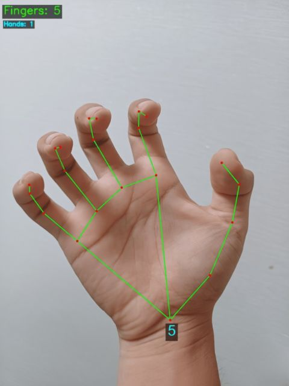
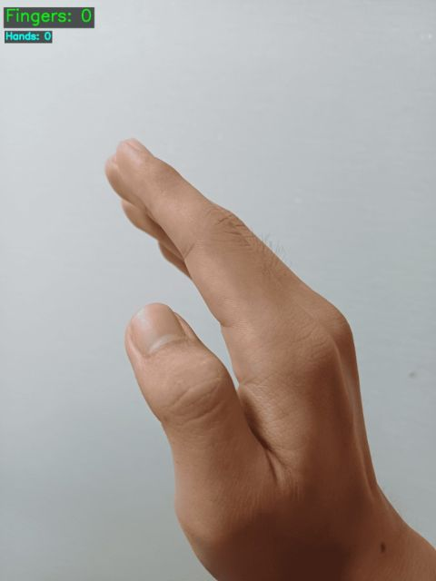

# 실시간 손가락 개수 판별 (MediaPipe) - 1조 LOOK

손 사진 / 영상 / 웹캠에서 손을 인식해 **펼친 손가락이 몇 개인지** 맞힌다.
(이미 학습된 MediaPipe 손 모델을 활용하며, 모델을 새로 학습하지 않는다.)

**대상**: 5주 / 조별 / CPU(일반 Windows PC) / 웹캠은 선택(사진만으로도 실행됨)
(교사 제공 `README-원본.md` 와 `PROJECT.md` 의 항목 순서(1~9)에 맞춰 정리했다. 원본의 `source/`, `outputs/` 는 이 프로젝트에서 각각 `src/`, `output/` 이다.)

## 1. 목적
손 관절 위치(21개)를 찾고 **펼친 손가락 개수를 휴리스틱(거리·각도 규칙)으로 추정**한다. 사진 모드가 필수이고, 영상·웹캠 모드는 추가 기능이다.

## 2. 모델과 데이터
- 사전 학습 모델: `models/hand_landmarker.task` (MediaPipe 손 랜드마크 모델. 저장소에 포함되어 있고, 모델을 새로 학습하지 않는다). 없으면 아래 '환경 설치'의 주소에서 받는다.
- 입력: 손 사진 **36장** (`data/inputs/images/t014.jpg ~ t049.jpg`, 20장 이상). 그중 `t021~t049` 29장 가운데 7장(`t021=t015`, `t022=t014`, `t026=t019`, `t027=t018`, `t029=t017`, `t030=t016`, `t043=t020`)은 `t014~t020` 과 **같은 파일**이다. 영상은 `data/inputs/videos/` 에 넣는다(지금은 없음).
- 데이터 조건: 손가락 0~5개, 여러 각도(정면, 옆모습, 기울임, 가려짐), 손을 크게 찍은 사진 위주.
- 개인정보·저작권·촬영 동의: 사람이 찍힌 원본 사진은 외부에 공개하지 않는다. (촬영 동의 여부와 GitHub 저장소 공개 설정(비공개 권장)은 팀에서 확인한다.)
- 사진이 너무 크면(가로 960px 초과) 비율을 유지한 채 줄여서 처리·저장한다(아래 '실행' 참고).

## 3. 처음 실행 (Windows PowerShell)
```powershell
cd C:\DHC\pjt_LOOK                       # 실제 폴더 위치에 맞게 수정
python -m venv .venv                      # Python 3.11 (개발 환경 3.11.9)
.\.venv\Scripts\Activate.ps1
pip install -r requirements.txt           # mediapipe 0.10.35 포함
python src\main-2.py --mode IMAGE         # data/inputs/images 의 모든 사진 -> output/
```
- 모델 파일이 없으면 `FileNotFoundError: 모델 파일이 없습니다` 가 나온다. 사진 폴더가 비어 있으면 `data/inputs/images 폴더에 손 사진을 먼저 넣어 주세요.` 라고 알려 준다.
- 입력 파일 이름이 다르면 `--input` 옵션을 쓴다. 예: `python src\main-2.py --mode IMAGE --input data\inputs\images\t017.jpg`
- 자세한 옵션: `python src\main-2.py --help`
- 가상환경 없이 확인만 하려면 `.\.venv\Scripts\python.exe src\main-2.py --mode IMAGE`

## 4. 출력과 성공 기준
- 결과는 `output/` 에 **원본과 다른 이름**으로 저장된다. 원본 사진은 수정하지 않는다.
  - `output/t014_result.jpg` : 뼈대(펴짐 파랑 / 접힘 빨강), 관절 번호, 손가락 개수를 그린 결과 사진 (사진마다 1장)
  - `output/finger_results.csv` : 예측표. `입력파일명, 예측(손개수), 예측(손가락개수), 손별개수` (프로그램이 작성. 같은 내용의 `image_results.csv` 도 같이 저장)
- 실행하면 `t017.jpg: 손 1개, 손가락 5개 [5]` 처럼 사진별 결과가 화면에 출력된다.
- 성공 기준: **입력 -> 손 검출/분석 -> 저장**이 정상 실행되고, 사진별 실제 수와 예측 수를 비교할 수 있을 것. (사전 정확도 목표는 없다. 틀린 사례는 이유를 설명한다: 아래 '오류 찾고 수정한 기록', '아직 안 되는 경우')
- 한계: 손 회전, 가림, 엄지 판별에서 오차가 생긴다.

## 5. 검증 방법
1. 정답표 `data/ground_truth.csv` (열: `입력파일명, 정답(손가락개수)`)에 사람이 직접 센 **진짜 정답만** 적는다. 지금은 사진 36장 전체가 적혀 있다. 처음 14장은 팀이 정했고, 나머지 22장(`t023~t049` 중 빠졌던 것)은 사진을 눈으로 보고 센 값을 이번에 채웠다(프로그램 결과를 베끼지 않았다). 헷갈리는 사진(`t042`, `t049`)은 팀이 한 번 더 세어 확인한다.
2. 프로그램을 실행하고 `python src\evaluate.py` 를 실행하면 예측표 `output/finger_results.csv` 의 `예측(손가락개수)` 와 정답표를 사진마다 비교해 절대오차 `|예측 - 실제|` 와 일치율을 보여 주고, 오차분석표 `data/test_cases.csv` 를 다시 쓴다.
3. 현재 결과: 정답표 **36장 중 36장 일치**(평균 절대오차 0.00). 단, 이 사진들로 판정 기준을 고쳐 왔기 때문에 새 사진에서는 틀릴 수 있다. 처음 사진 7장(`t014~t020`)은 7/7 이다 (정답 3, 4, 3, 5, 2, 3, 4).
4. 오차분석표 `data/test_cases.csv`: 사진 36장마다 `검출`(손 개수)과 `분류`(손가락 개수) 두 줄, 그리고 오류 처리 5건(빈 폴더, 없는 파일, 잘못된 형식, 모델 없음, 손 없음). 열은 `테스트id, 시나리오_id, 기대동작, 입력파일명, 예측(개), 정답(개), 개수오차합, 성공여부(y/n), 오류유형, 원인분류`. `검출`의 개수는 손 개수, `분류`의 개수는 손가락 개수다. 틀리면 오류유형이 `미검출` 또는 `오류검출`이다.
5. 틀린 사례와 그때의 입력 조건은 '오류 찾고 수정한 기록'과 '아직 안 되는 경우'에 적어 두었다. 발표용 실패 사례 3개:
   - 손을 옆으로 눕히고 약지·새끼를 카메라 쪽으로 말면 3개인데 5개로 나온다(화면에서는 곧게 보이고 깊이로만 구분되는 자세).
   - 손이 화면을 너무 꽉 채운 사진에서는 손이 검출되지 않는다(MediaPipe 한계. 30~50cm 띄워 찍는다).
   - 웹캠 화면이 너무 밝으면(밝기 x2.0 이상) 손 검출이 3/7, x3.0 에서 0/7 로 떨어진다.

### 정답과 예측 비교표
`python src\evaluate.py` 결과(`output/evaluation.csv`)를 옮긴 것이다. 사진이나 정답표가 바뀌면 이 표는 다시 만들어야 한다(표 아래 요약 참고).

| 번호 | 파일 | 정답 | 예측 | 절대오차 | 결과 |
|:-:|---|:-:|:-:|:-:|:-:|
| 1 | t014.jpg | 3 | 3 | 0 | 일치 |
| 2 | t015.jpg | 4 | 4 | 0 | 일치 |
| 3 | t016.jpg | 3 | 3 | 0 | 일치 |
| 4 | t017.jpg | 5 | 5 | 0 | 일치 |
| 5 | t018.jpg | 2 | 2 | 0 | 일치 |
| 6 | t019.jpg | 3 | 3 | 0 | 일치 |
| 7 | t020.jpg | 4 | 4 | 0 | 일치 |
| 8 | t021.jpg | 4 | 4 | 0 | 일치 |
| 9 | t022.jpg | 3 | 3 | 0 | 일치 |
| 10 | t023.jpg | 2 | 2 | 0 | 일치 |
| 11 | t024.jpg | 1 | 1 | 0 | 일치 |
| 12 | t025.jpg | 1 | 1 | 0 | 일치 |
| 13 | t026.jpg | 3 | 3 | 0 | 일치 |
| 14 | t027.jpg | 2 | 2 | 0 | 일치 |
| 15 | t028.jpg | 1 | 1 | 0 | 일치 |
| 16 | t029.jpg | 5 | 5 | 0 | 일치 |
| 17 | t030.jpg | 3 | 3 | 0 | 일치 |
| 18 | t031.jpg | 5 | 5 | 0 | 일치 |
| 19 | t032.jpg | 5 | 5 | 0 | 일치 |
| 20 | t033.jpg | 0 | 0 | 0 | 일치 |
| 21 | t034.jpg | 0 | 0 | 0 | 일치 |
| 22 | t035.jpg | 4 | 4 | 0 | 일치 |
| 23 | t036.jpg | 1 | 1 | 0 | 일치 |
| 24 | t037.jpg | 3 | 3 | 0 | 일치 |
| 25 | t038.jpg | 1 | 1 | 0 | 일치 |
| 26 | t039.jpg | 2 | 2 | 0 | 일치 |
| 27 | t040.jpg | 3 | 3 | 0 | 일치 |
| 28 | t041.jpg | 4 | 4 | 0 | 일치 |
| 29 | t042.jpg | 3 | 3 | 0 | 일치 |
| 30 | t043.jpg | 4 | 4 | 0 | 일치 |
| 31 | t044.jpg | 5 | 5 | 0 | 일치 |
| 32 | t045.jpg | 0 | 0 | 0 | 일치 |
| 33 | t046.jpg | 0 | 0 | 0 | 일치 |
| 34 | t047.jpg | 3 | 3 | 0 | 일치 |
| 35 | t048.jpg | 1 | 1 | 0 | 일치 |
| 36 | t049.jpg | 2 | 2 | 0 | 일치 |

요약: 36장 중 일치 36장, 평균 절대오차 0.00. 이 사진들로 판정 기준을 고쳐 왔으므로 새 사진에서는 틀릴 수 있다. 사진 7장은 다른 사진과 같은 파일이라(위 2번 항목) 서로 다른 사진은 29장이다.

## 6. 필수와 선택 구분
| 구분 | 내용 | 이 프로젝트 |
|---|---|---|
| 필수(A) | 입력 -> 검출/분석 -> 저장 정상 실행 | `main-2.py --mode IMAGE` 로 사진 36장 처리, `output/` 저장 |
| 권장(B) | 핵심 기능 적용 + 실제 정답과 비교 | 손가락 판정(`finger_classifier.py`) + 정답표 비교(36장 36/36, `src/evaluate.py`) |
| 선택(C) | 여러 입력 처리, 결과 표시 개선 등 | 사진 여러 장 반복 처리, 영상·웹캠 모드, 펴짐/접힘 색 표시와 관절 번호, 좌표 떨림 제거 |

## 7. 오류 처리 팁
- `ModuleNotFoundError`: 가상환경이 켜져 있는지(프롬프트 앞 `(.venv)`) 확인한다. 이 프로젝트의 `.venv` 로 실행해야 한다(`.\.venv\Scripts\python.exe`).
- `FileNotFoundError`: `data/inputs/images` 와 `models/hand_landmarker.task` 경로를 확인한다. 한글·네트워크 경로에서도 읽을 수 있게 `data_loader.read_image` 로 읽는다.
- 손이 검출되지 않으면 밝고 손이 크게(너무 꽉 차지 않게) 나온 사진으로 먼저 시험한다.
- 웹캠이 열리지 않으면 카메라 연결/허용 여부와 다른 프로그램(줌, 카카오톡 등)의 카메라 사용 여부를 확인한다.
- 판정이 이상할 때는 웹캠 모드에서 `d` 키(손가락별 판정 이유 표시), `s` 키(원본·관절 좌표·판정 이유 저장)를 쓴다.

## 8. 제출물
| 항목 | 상태 | 위치 |
|---|---|---|
| 실행 소스 | 있음 | `src/main-2.py`(최신), `src/main-1.py`(구버전, 사진만) 와 나머지 모듈 |
| 결과물 2개 이상 | 있음 | `output/` 의 결과 사진 36장 + 예측표 `finger_results.csv` (실행하면 다시 만들어진다) |
| 정답표 | 있음 (36장) | `data/ground_truth.csv` |
| 오차분석표 | 있음 (사진 36장 × 검출/분류 + 오류 처리 5건) | `data/test_cases.csv` |
| 채점 프로그램 | 있음 | `src/evaluate.py` -> `output/evaluation.csv` |
| 수정 기록 | 있음 | 이 문서의 '오류 찾고 수정한 기록', `src/finger_classifier.py` 맨 위 '수정 기록' |
| 3분 시연 | 준비 필요 | 사진 모드 실행 -> 결과 사진 -> 웹캠 시연 순서 |

## 9. 예상 출력 파일과 첫 번째 수정 실습
`python src\main-2.py --mode IMAGE --input data\inputs\images\t017.jpg` 를 실행하면 `output/` 에 다음 파일이 생긴다.
- `t017_result.jpg`
- `finger_results.csv` (이 경우 예측표에는 그 사진 1장만 들어간다. 전체 결과는 `--input` 없이 다시 실행한다.)

**수정 실습:** `src/finger_classifier.py` 위쪽의 `THRESHOLD_ANGLE`(검지~새끼가 접힘으로 바뀌는 PIP 관절 각도, 지금 90)을 바꿔 다시 실행하고, `finger_results.csv` 의 손가락 개수가 어떻게 달라지는지 비교한다. (교사 원본의 `150` 에 해당한다. 이 프로젝트는 기준을 단순하게 하려고 90 으로 정했다.)

## 10. 프로젝트 명세서(`PROJECT.md`) 요구사항 대응
| 요구 | 내용 | 상태 | 확인 방법 / 위치 |
|---|---|---|---|
| F1 필수 | 입력을 읽고, 입력이 없으면 알아볼 수 있는 오류 메시지 | 완료 | 아래 '예외 시나리오' 표 |
| F2 필수 | 사전 학습 모델로 관절 좌표 분석 | 완료 | `models/hand_landmarker.task` (MediaPipe), `src/landmark_extractor.py` |
| F3 필수 | 결과 이미지/CSV 저장, 원본 수정 금지 | 완료 | `output/*_result.jpg`, `output/finger_results.csv` (원본은 읽기만 한다) |
| F4 권장 | 정답표와 비교, 개수 오차 기록 | 완료 | `data/ground_truth.csv`(36장), `src/evaluate.py`, `data/test_cases.csv` (36/36 일치, 이 사진들로 기준을 고쳤으므로 새 사진에서는 달라질 수 있음) |
| F5 선택 | 반복 처리/표시 개선 중 1개 | 완료(여러 개) | 폴더 전체 반복 처리, 영상·웹캠, 색·번호 표시, 떨림 제거 |

**예외 시나리오 (`main-2.py --mode IMAGE`)**
| 상황 | 프로그램 동작 |
|---|---|
| 입력 폴더가 비어 있음 | `data/inputs/images 폴더에 손 사진을 먼저 넣어 주세요.` 출력 후 종료 |
| `--input` 파일이 없음 | `입력 파일이 없습니다: 경로 (경로와 파일 이름을 확인하세요)` 출력 후 종료 |
| 잘못된 파일 형식(사진이 아니거나 깨진 파일) | `사진으로 읽을 수 없어 건너뜁니다.` 출력하고 다음 사진으로 계속 진행 |
| 모델 파일이 없음 | `모델 파일이 없습니다: 경로` 출력 |
| 손이 검출되지 않음 | `손이 검출되지 않았습니다.` 출력, 결과는 손 0개 / 손가락 0개로 저장 |

**5주 일정 확인**
| 주 | 필수 제출물 | 상태 |
|---|---|---|
| 1주 | 사진/영상 입력 성공 화면 | 완료 |
| 2주 | Go/No-Go: 입력 -> 처리 -> 저장 성공 | 통과 (사진 모드) |
| 3주 | F1~F3 완성, 핵심 코드 설명 | 기능 완료, 코드 설명(발표용)은 담당자별 준비 필요 |
| 4주 | `ground_truth.csv`, `test_cases.csv` 완성 | 완료: 정답표 36장, 오차분석표는 검출/분류 72줄 + 오류 처리 5줄 |
| 5주 | 실행 소스, 출력물, 3분 시연, 한계 설명 | 시연·PPT 준비 필요 (한계 설명 재료는 이 문서에 있음) |

**평가 기준 (100점) 대비:** 핵심 기능 35(F1~F3 완료), 환경 재현 15(`requirements.txt`, 3번 항목), 검증 15(정답표 36장, `test_cases.csv`, 실패 사례 정리), 코드 이해 20(담당 함수 설명 필요), 협업 10(담당 기록), 발표 5(3분 시연).

**안전·AI 사용:** 사진은 촬영 동의/사용권이 있는 것만 쓰고, 얼굴이 나온 원본은 외부에 공개하지 않는다(사진을 올린 저장소의 공개 여부를 팀이 확인해야 한다). 코드 수정은 모두 실행해 결과를 확인했고(사진 7/7), 학생별 수정 1건 이상과 담당 함수 1개 설명은 위 '역할별 파일' 표를 기준으로 팀에서 따로 정리한다.

**AI 사용 제출물(추천 10선 문서 8장 기준):** (1) AI에 요청한 대표 프롬프트 2~3개, (2) 받은 코드에서 실제로 고친 부분, (3) 발견한 오류와 해결 기록. 이 중 (2),(3)은 아래 '오류 찾고 수정한 기록'과 `src/finger_classifier.py` '수정 기록'에 있다. (1)은 각자 대화 기록에서 골라 따로 적어야 한다.

---
이 아래는 **상세 자료**(폴더 구조, 역할, 버전, 판정 규칙, 수정 기록)다.

## 진행 상황
- [x] **1주차**: 환경 세팅, 사진 읽기, 손 랜드마크(21개 관절) 추출
- [x] **2주차**: 손가락 개수 판정(`finger_classifier.py`), 뼈대·숫자 그리기와 결과 저장(`visualizer.py`) - 사진 모드 완성
- [x] 정답표 작성 및 비교 (36장 36/36, `src/evaluate.py` 로 자동 채점)
- [x] `data/test_cases.csv` (검출/분류 72줄 + 오류 처리 5줄)
- [x] 영상 / 웹캠 모드 (`main-2.py --mode VIDEO / WEBCAM`)

## 폴더 구조
```
pjt_LOOK/
  data/
    inputs/images/     # 손 사진
    inputs/videos/     # 손 영상
  models/hand_landmarker.task   # MediaPipe 손 모델
  output/              # 결과 이미지·CSV (git에는 올라가지 않음)
  src/
  requirements.txt
```

## 역할별 파일
각자 **자기 파일 맨 위 주석**에 적힌 함수를 말로 설명하고, 거기에 적힌 숫자 하나를 바꾼 뒤 다시 실행한다.

| 담당 | 이름 | 파일 | 설명할 함수 | 바꿀 값 |
|---|---|---|---|---|
| 1. 통합·발표 | 당형청 | `src/main-2.py` | `analyze`, 데이터 흐름 | `MODE` |
| 2. 입력 데이터 | 이다영 | `src/data_loader.py` | `read_image`, `resize_image` | `RESIZE_MAX_WIDTH`, `FRAME_INTERVAL` |
| 3. 랜드마크 | 당현청 | `src/landmark_extractor.py` | `extract_from_image`, `_to_hands` | `MIN_DETECTION_CONFIDENCE`, `MAX_NUM_HANDS` |
| 4. 손가락 판정 | 고희철 | `src/finger_classifier.py` | `is_finger_open`, `is_thumb_open` | `THRESHOLD_ANGLE`, `THUMB_ANGLE` |
| 5-A. 화면 그리기 | 정민서 | `src/visualizer.py` | `draw_skeleton`, `draw_total` | `TEXT_COLOR`, `FONT_SCALE` |
| 5-B. 결과 저장 | 박현준 | `src/visualizer.py` | `save_image`, `save_csv` | `IMAGE_CSV_COLUMNS` |
| 추가 | | `src/smoothing.py` | `OneEuroFilter`, `MultiHandSmoother` (웹캠 좌표 떨림 제거) | `MIN_CUTOFF`, `BETA` |
| 6. 검증·오류 분석 | 함현준 | `src/evaluate.py`, `data/ground_truth.csv`, `data/test_cases.csv` | `read_rows`, `main` (정답과 예측 비교, 절대오차) | 정답표 값, 오차 계산 방식 |
| 공통 | | `src/config.py` | 폴더 경로. 수정하지 않는다 | |

데이터 흐름: `data_loader` -> `landmark_extractor` -> `finger_classifier` -> `visualizer`

## 환경 설치
```
python -m venv .venv
.venv\Scripts\activate
pip install -r requirements.txt
```
모델 파일(`models/hand_landmarker.task`)이 없으면 아래에서 받아 `models/`에 넣는다.
https://storage.googleapis.com/mediapipe-models/hand_landmarker/hand_landmarker/float16/latest/hand_landmarker.task

## 버전 (실행 파일)
| 파일 | 버전 | 내용 |
|---|---|---|
| `src/main-1.py` | 구버전 | 사진 모드만 (사진 -> 판정 -> `output/` 저장). 제출용으로 남겨 둔 처음 버전 |
| `src/main-2.py` | **최신** | 사진 + 영상 + 웹캠, 손가락별 안정화(`FingerStabilizer`), 픽셀 좌표 변환·깊이 제외(`USE_DEPTH`), 3D 좌표 판정, One Euro Filter 떨림 제거(`USE_SMOOTHING`, `src/smoothing.py`), 펴짐 파랑/접힘 빨강 선 + 관절 번호(`SHOW_JOINT_IDS`), `s` 키로 원본·관절 좌표 저장 |

두 파일은 `finger_classifier.py`, `data_loader.py`, `landmark_extractor.py`, `visualizer.py`를 **같이** 쓴다. 판정 기준 값은 두 버전에서 같다.

## 실행 (프로젝트 루트에서)
아래 명령은 최신 버전(`main-2.py`) 기준이다. 구버전은 `python src/main-1.py` (사진만).
```
python src/main-2.py                                      # main-2.py 위쪽 MODE 값대로 실행 (기본 IMAGE)
python src/main-2.py --mode IMAGE                         # data/inputs/images 전체 -> output/ + finger_results.csv
python src/main-2.py --mode IMAGE --input data/inputs/images/t17.jpg   # 사진 1장
python src/main-2.py --mode VIDEO --save                  # data/inputs/videos 의 첫 영상 -> 결과 영상 + CSV
python src/main-2.py --mode VIDEO --input data/inputs/videos/a.mp4 --save --no-show
python src/main-2.py --mode WEBCAM                        # 실시간 웹캠 (--camera 1 로 카메라 변경)
```
- 웹캠으로 바꾸려면 `src/main-2.py` 위쪽 `MODE = "IMAGE"` 를 `"WEBCAM"` 으로 바꾸거나, 위처럼 `--mode WEBCAM` 을 붙인다.
- VIDEO/WEBCAM 키: `q`/`ESC` 종료, `s` 현재 화면 저장(뼈대 화면 + 원본 `_raw.png` + 관절 좌표 `_landmarks.csv` + 판정 이유 `_metrics.csv`), `d` 손가락별 판정 이유 표시 켜기/끄기

**`main-2.py` 위쪽 설정 스위치**

| 설정 | 기본값 | 하는 일 |
|---|---|---|
| `MODE` | `"WEBCAM"` | 기본 입력 (`IMAGE` / `VIDEO` / `WEBCAM`). `--mode`로 덮어쓸 수 있다 |
| `USE_SMOOTHING` | `True` | 관절 좌표 떨림을 One Euro Filter 로 줄인다 (`src/smoothing.py`) |
| `USE_DEPTH` | `False` | 화면 좌표의 깊이 z 를 판정에 쓸지. 웹캠 z 는 흔들려서 끔 |
| `USE_HIDDEN_THUMB` | `True` | 손끝(엄지·검지~새끼)이 다른 관절 뒤에 가려져 있으면(화면에서 그 관절 번호가 숨겨지는 경우) 그 손가락을 접힘으로 판정. 가려졌는데 펴짐이 나오면 `True`, 오히려 이상하면 `False` 로 비교 |
| `USE_WORLD` | `True` | 실제 3D 좌표(`hand_world_landmarks`)로 접힘/가려진 엄지를 추가 판정. 옆모습에서 이상하면 `False` 로 비교 |
| `SHOW_JOINT_IDS` | `True` | 관절 번호 표시 (가려진 관절은 자동으로 숨김) |
| `SMOOTH_FRAMES` | `5` | 전체 숫자를 최근 N프레임의 최빈값으로 보여준다 |
- 웹캠이 열리지 않으면 카메라 연결/허용 여부와 다른 프로그램(줌, 카카오톡 등)의 카메라 사용 여부를 확인한다.

출력 예: `t17.jpg: 손 1개, 손가락 5개 [5]` / 결과 사진은 `output/t17_result.jpg`

입력 사진(또는 영상 프레임)의 **가로가 `RESIZE_MAX_WIDTH`(960px)보다 크면** 비율을 유지한 채 가로 960px로 줄인 뒤 판정하고, 그 줄어든 이미지를 `output/`에 저장한다(`data_loader.resize_image`, 사진 읽기 `read_image` 안에서 호출). 가로가 960px 이하면 원본 크기 그대로다. `RESIZE_MAX_WIDTH`를 `0`으로 두면 줄이지 않는다.

## 화면 표시 (main-2.py)
- **선 색:** 펴진 손가락은 **파랑**, 접힌 손가락은 **빨강**, 손바닥 선(손목~손가락 뿌리)은 회색. 오른쪽 위에 Open/Closed 범례가 있다.
- **관절 번호:** 관절마다 작은 번호(0 손목, 1~4 엄지, 5~8 검지, 9~12 중지, 13~16 약지, 17~20 새끼)를 쓴다. SHOW_JOINT_IDS = False로 끌 수 있다.
- **가려진 관절 번호는 숨김:** 화면에서 다른 관절과 가까이 겹치고 그쪽이 카메라에 더 가까우면(깊이 z) 가려진 관절로 보고 번호를 쓰지 않는다. 글씨끼리 겹치면 카메라에 가까운 쪽만 쓴다. 옆모습이나 손가락이 겹친 자세에서 번호가 지저분해지는 것을 막는다.
- 구버전(main-1.py)은 예전 표시(초록 선 + 빨간 점) 그대로다.

## 손가락 판정 규칙
- 검지~새끼: PIP 관절이 `THRESHOLD_ANGLE`(기본 90도) 이하로, 즉 **90도 이상 꺾여야 접힘**. 그보다 덜 꺾이면 펴짐. 손끝이 PIP 보다 손목에 가까우면(손바닥 쪽으로 말림) 접힘.
  (기준을 단순하게 둔 대신, 살짝~중간 정도 굽힌 손가락은 펴짐으로 센다)
- 엄지: (새끼 MCP~엄지 끝 거리) > (새끼 MCP~엄지 IP 거리) x `THUMB_RATIO` **그리고** 엄지 IP 관절 각도 > `THUMB_ANGLE`(기본 90도) 이면 펴짐. 단, 엄지 끝이 검지 뿌리(`THUMB_SPREAD_RATIO` 0.5)나 손바닥 중심(`THUMB_CENTER_RATIO` 0.7)에 가까우면 손바닥 위로 접힌 엄지라서 굽힘 (V 사인)
- 엄지끝과 다른 손끝이 `THUMB_TOUCH_RATIO`(손바닥 크기의 0.25배)보다 가까우면 **닿은 것**으로 보고 **닿은 손가락**은 굽힘으로 처리한다. 엄지가 곧게 뻗었으면 엄지는 펴짐으로 센다 (OK 사인 = 엄지 + 나머지 3개 = 4개).
- 거리·각도 기반이라 손이 기울어져도 동작한다. 판정 전에 좌표를 픽셀 단위로 바꾸고(가로로 긴 웹캠 보정), 깊이 z 는 쓰지 않는다(`USE_DEPTH = False`, `main-2.py`).

## 오류 찾고 수정한 기록 (2026-10-27 ~ 10-28)
자세한 수치는 `src/finger_classifier.py` 맨 위 주석의 '수정 기록'에 있다. 아래는 **날짜 순서**로 정리했고, 지금은 다른 규칙으로 바뀐 것은 `(대체됨)`으로 표시했다.
확인은 사진 7장(당시 이름 `t14~t20`, 지금은 `t014~t020`으로 바뀜. 정답은 `data/ground_truth.csv`)으로 했고, 지금 7/7(3, 4, 3, 5, 2, 3, 4)이다.

### 1. 사진 판정 수정 (10-27)
| 증상 | 원인 | 수정 |
|---|---|---|
| 엄지척이 0개로 나옴 | 엄지 각도 154도가 기준 155도에 1도 차이로 걸림 | `THUMB_ANGLE` 155 -> 145 |
| OK 사인에서 엄지를 접었다고 나옴 | 엄지 각도 144도가 기준 145도에 또 1도 차이로 걸림 | `THUMB_ANGLE` 145 -> 135 (편 엄지 144도 이상 / 굽힌 엄지 117~123도의 가운데). (대체됨: 10-28에 90도로 단순화) |
| 갈고리처럼 굽힌 손이 4~5개로 나옴 | PIP 각도만으로는 갈고리 손(144~161도)과 편 손(147~173도)이 겹침 | 끝마디(DIP) 각도 조건 추가 160. (대체됨: 곧음비를 거쳐 10-28에 삭제) |
| 세 손가락이 2개로 나옴 (약지를 올렸는데 굽힘) | 약지 끝마디 각도가 146도라 위의 160도 조건에 걸림 | DIP 160 -> 142. (대체됨) |
| 갈고리 손의 정답을 5로 잘못 읽고 '벌어진 엄지는 펴짐' 규칙을 넣음 -> 갈고리 손이 5개로 나옴 | 정답을 잘못 읽고 넣은 규칙 (정답은 0개) | 규칙 삭제, 엄지 기준 복구 |
| README 의 'OK 사인 = 3개'가 코드와 다름 | 코드는 곧은 엄지를 펴짐으로 센다 | README 를 4개로 정정 |

재현 사진 (2026-10-30). 화면 숫자는 예전 판정이고, 괄호 안이 나와야 하는 개수다.

**t001. 엄지척이 0 (정답 1).** 위 표 첫 줄. 편 엄지가 기준 각도에 1도 못 미쳐 접힘으로 세졌다.



**t028. 같은 엄지척이 0 (정답 1).** 지금 폴더의 `t028.jpg`를 예전 판정(커밋 2)으로 보면 0이다. 화면 왼쪽 위는 손 0으로도 찍혀 있으나 뼈대는 그려져 있고, 틀린 값은 손가락 0이다.



**t016. 손가락 세 개인데 2 (정답 3).** 위 표에서 약지를 굽힘으로 본 줄. 끝마디 각도 조건이 너무 높았다.



**t039. 브이 사인인데 1 (정답 2).** 같은 조건에서 편 손가락이 하나 빠졌다. 커밋 3에서 `t039.jpg`가 1로 나왔다.



**t017. 활짝 편 손은 5 (정답 5).** 이 장은 틀린 사례가 아니다. 사진 7장 중 맞던 `t017`을 다시 찍은 것이고, 재현 화면도 5다.



### 2. 웹캠에서만 틀리던 문제 (10-28)
사진은 7/7인데 실시간 웹캠에서는 틀려서, 원인을 하나씩 확인하며 고쳤다.

| 증상 | 원인 | 수정 |
|---|---|---|
| V 사인이 3개, 활짝 편 손이 4개로 나옴 | 손바닥을 가로질러 접힌 엄지를 펴짐으로 셈 / 손에 붙은 엄지가 기준 0.6 에 아슬아슬하게 걸림 | `THUMB_CENTER_RATIO` 0.7 추가, `THUMB_SPREAD_RATIO` 0.6 -> 0.5 |
| 각도가 조금만 달라져도 숫자가 뒤집힘 | 손가락 판정이 8%, 4도 차이로 걸려 있어 좌표 떨림에 약함 | 거리 + DIP 각도 조건을 곧음비 0.90 으로 교체 (정답 유지율 2% 떨림에서 91% -> 98%, 4% 떨림에서 53% -> 85%). (대체됨: 아래 90도 단순화에서 삭제) |
| 프레임마다 숫자가 깜빡임 | 웹캠은 프레임마다 관절 좌표가 떨림. 손별 숫자는 평균도 없었음 | 손가락별 안정화 `FingerStabilizer` (최근 7프레임 중 반대 상태가 4번 이상이어야 변경). 숫자가 바뀐 횟수 4% 떨림에서 101 -> 18. 웹캠/영상 전용 |
| 엄지만 펴고 주먹을 쥐었는데 2개 | (1) 곧음비로 바꾸면서 '손끝이 PIP 보다 손목에 가까우면 접힘' 조건이 빠짐 (2) 좌표가 0~1 정규화 값이라 가로로 긴 웹캠(640x480)에서 가로 거리가 짧게 계산되어, 옆으로 뻗은 엄지가 '검지에 붙었다'로 오판 | (1) 조건 복구 (2) `_to_pixels`로 판정 전에 픽셀 좌표로 변환 |
| 엄지 올린 주먹(정답 1개)이 2~3개로 깜빡임 | 웹캠의 깊이값 z 가 손 크기만큼 크고 프레임마다 흔들려서 접힌 손가락의 거리·각도가 뒤틀림. 같은 좌표를 x, y 만으로 재면 정답 | `USE_DEPTH = False`: 판정에 z 를 쓰지 않음 (`main-2.py`) |
| 기준이 여러 개라 설명하기 어렵고 경계에서 뒤집힘 | 곧음비 0.90, PIP 120도, 엄지 135도 등이 섞여 있음 | 90도 이상 꺾여야 접힘으로 단순화: 곧음비 삭제, `THRESHOLD_ANGLE` 120 -> 90, `THUMB_ANGLE` 135 -> 90 |
| 손을 돌리거나 옆모습이면 틀리고, 뼈대 선이 심하게 흔들림 | (1) 화면(2D)에서 접힌 손가락의 PIP 각도가 100~120도라 90도 기준에 안 걸림. 실제 3D 좌표로 재면 76~91도 (2) 프레임마다 좌표가 떨림 | (1) MediaPipe 의 실제 3D 좌표(`hand_world_landmarks`)로 `거리비 < 1.25` 또는 `PIP 각도 <= 115도`이면 접힘 조건 추가 (2) **One Euro Filter**(`src/smoothing.py`)로 좌표 평활화. 웹캠처럼 흔든 시험: 엄지 올린 주먹 숫자 67번 바뀜 -> 0번, 정답 1 고정 / 옆모습 80번 -> 1번 |
| 가운데 손가락만 세웠는데 2개 (엄지가 손 뒤에 가려짐) | 모델은 가려진 관절도 21개를 항상 채워서, 화면(2D)에서 가려진 엄지 점이 길게 뻗은 엄지처럼 찍힘 | 3D 로 `엄지끝~검지뿌리 / 손바닥 < 0.45`이면 손에 붙은 엄지(굽힘). 편 엄지 0.54~0.71, 가려진 엄지 0.33. 흔든 시험 150프레임 모두 1개 |
| V 사인에서 엄지를 접었는데 펴짐으로 나와 3개 | 접은 엄지 끝이 접힌 손가락 끝마디와 겹쳐 'OK 사인' 규칙이 작동해 엄지를 곧게 뻗은 것으로 셈. 손바닥 중심 거리(0.8배)도 기준 0.7 을 넘음 | 엄지 끝이 접힌 손가락 관절에서 손바닥의 0.5배 안이고 손바닥 중심에서 1.2배 안이면 엄지를 접힘으로 처리(`_thumb_over_curled_fingers`). 편 엄지는 0.95배 이상, OK 사인은 중심에서 멀어 해당 없음 |
| 옆모습 엄지척에서 엄지가 접힘(빨강)으로 나와 0개 (2026-10-28) | 화면(2D)으로는 엄지가 손 위로 길게 뻗어(검지뿌리에서 손바닥의 1.07배, 중심에서 1.8배, 각도 150도) 펴짐인데, 위의 '3D 엄지 판정'이 옆모습에서 틀어진 3D 값 때문에 접힘으로 덮어썼을 가능성이 큼 | 3D 엄지 판정은 엄지 끝이 화면에서 손바닥 중심의 1.3배 안일 때만 적용(`WORLD_THUMB_CENTER_MAX`). 가려진 엄지(중심 0.9배)는 그대로 접힘. **뼈대 없는 원본이 없어 이 화면은 재현하지 못했다.** 확인용으로 `d` 키에 엄지 판정 이유 표시를 추가 |
| 카메라 쪽으로 내민 주먹에서 접은 엄지가 펴짐(파랑)으로 나와 1개 (2026-10-28) | 손바닥 크기를 '손목~중지 뿌리' 길이로만 쟀는데 손끝이 카메라를 향하면 원근 때문에 짧아져(56px, 손바닥 너비는 135px) 엄지~손바닥 중심 거리비가 2.5배로 부풀었다. 그래서 바로 위 행의 `center < 1.3` 조건이 3D 엄지 판정과 '포갠 엄지' 규칙을 둘 다 꺼 버렸다 | `_palm_size()`: 손바닥 길이와 `너비 / 0.85` 중 큰 쪽을 손바닥 크기로 사용(`PALM_WIDTH_RATIO`). 이 자세의 거리비가 0.91배로 정상화되어 접힘 처리. 옆모습은 길이가 그대로라 영향 없음 |
| 기울어진 엄지척에서 편 엄지가 접힘(빨강)으로 나와 0개 (2026-10-28, `s` 로 저장한 캡처로 확인) | 바로 위 수정의 부작용. 손바닥 크기가 커지자 엄지 끝~손바닥 중심 거리비가 1.8 -> 1.1 로 줄어 '포갠 엄지' 규칙에 편 엄지가 걸렸다. 3D 엄지 거리(0.42~0.53)도 기준 0.45 에 아슬아슬해 프레임마다 갈렸다 | 규칙을 실제 측정값 사이로 조임: `THUMB_FOLD_DIST` 0.5 -> 0.3, `THUMB_FOLD_CENTER` 1.2 -> 1.0, `WORLD_THUMB_CENTER_MAX` 1.3 -> 1.0 (3D 거리는 가려진 엄지에만 적용). 이 캡처 150프레임 흔든 시험 0개 -> 1개 고정, 나머지 시험·사진 7/7 유지 |
| 손을 활짝 폈는데 엄지가 접힘(빨강)으로 나와 4개 (2026-10-28, `s` 캡처의 `_metrics.csv` 로 확인) | 판정 이유 `spread`: 엄지를 검지 쪽에 붙여서 폈더니 엄지 끝~검지 뿌리 거리가 손바닥의 0.26~0.30배라 '엄지가 손에 붙었다(0.5 미만)'로 판정. 하지만 엄지는 곧고(176도) 길었다(0.94배) | 엄지 뿌리~끝이 손바닥의 0.85배 이상이고 IP 각도 160도 이상(`THUMB_REACH_MIN`, `THUMB_STRAIGHT_ANGLE`)이면 '길고 곧은 엄지'로 보고 `spread`/`center` 규칙을 적용하지 않음. 가려진 엄지는 3D 규칙이 먼저 거름. 150프레임 시험 4 -> 5 고정, 나머지 유지 |
| 검지(5~8번)를 갈고리처럼 굽혔는데 펴짐(파랑)으로 나옴 (2026-10-28) | 관절 하나씩은 PIP 106도, DIP 126도로 90도 기준에 못 미쳐 펴짐 처리. 두 관절의 굽힘을 합치면 128도로 확실히 굽은 손가락 | PIP 굽힘 + DIP 굽힘 합계가 90도 이상이면 접힘(`THRESHOLD_TOTAL_BEND`, 이유 `hook`), 3D 합계 85도 이상도 접힘(`WORLD_TOTAL_BEND`). 실측 편 손가락 2D 최대 41 / 3D 최대 65. 사진 7/7 유지 |
| 손을 옆으로 펴서 엄지가 다른 손가락 뒤에 가려졌는데 엄지가 펴짐(파랑)으로 나와 5개 (2026-10-28) | 모델이 가려진 엄지 점을 손가락 사이 한가운데에 곧고 길게 찍음(엄지 뿌리~끝 1.2배). 화면(2D) 거리가 멀어 `spread`/`center` 규칙은 통과하고, 3D 판정은 `center2d < 1.0` 조건(편 엄지를 지키려고 넣은 것) 때문에 꺼짐. 판정 이유 값은 캡처가 없어 못 봄 | 이 판정의 기준을 엄지 값이 아니라 '가림'으로 바꿈: 엄지 끝이 다른 관절에서 손바닥의 0.16배 이내이고 그 관절이 카메라에 0.10배 더 가까우면 `hidden`(접힘). 화면에서 번호를 숨기는 기준과 같아서 '번호가 숨겨진 엄지 = 접힘'으로 설명됨. 켜고 끄는 스위치 `USE_HIDDEN_THUMB`. 편 엄지 시험 3종(150프레임)·사진 7장 유지. **이 화면에서 실제로 걸리는지는 아직 확인 못 함** |
| 손을 폈는데 엄지가 살짝 굽었다고 접힘(빨강)으로 나와 4개 (2026-10-28, `s` 캡처 2장의 `_metrics.csv` 로 확인) | 엄지가 손바닥 바깥으로 길게 뻗었지만(0.91~0.93배) 끝마디가 약간 굽어(147~158도) '길고 곧은 엄지'(160도 이상)에 못 들고 `spread`(검지 뿌리에 붙음)에 걸림. 통과해도 `near` 규칙에 걸릴 모양이었음 | 엄지 끝이 손바닥 바깥(손목~검지 뿌리 선의 반대쪽)에 있으면 140도 이상이면 펴짐(`THUMB_STRAIGHT_ANGLE_SIDE`), 이때 `near` 규칙도 건너뜀. 3D 엄지 기준 0.45 -> 0.42. 두 캡처 150프레임 시험 4 -> 5 고정, 나머지·사진 7/7 유지 |
| 엄지를 폈는데 손 각도가 달라지면 엄지가 접힘(빨강)으로 나와 4개 (2026-10-28, `s` 캡처 2장의 `_metrics.csv` 로 확인) | 화면에서 엄지는 곧고(175~179도) 손바닥 바깥에 있는데, 손을 기울이면 3D 엄지 거리가 0.20~0.33 으로 틀어져 `3D-spread` 로 접힘 판정(가려진 엄지 0.33~0.38 과 구분 불가). 다른 캡처는 엄지가 비스듬해 짧아 보여 `spread` 에 걸림 | 엄지가 손바닥 바깥에 있고 각도 140도 이상, 길이 0.65배 이상이면 '눈에 보이는 편 엄지'로 보고 3D 와 `spread`/`center`/`near` 규칙을 모두 건너뜀(`THUMB_REACH_MIN_SIDE`). 가려진 엄지는 z 기반 `hidden` 규칙이 거름. 두 캡처 150프레임 시험 5개 고정, 나머지·사진 7/7 유지 |
| 손을 아래로 향하게 폈는데 곧은 검지(5~8번)가 접힘(빨강)으로 나와 4개 (2026-10-28) | 화면에서 5-6-7-8 이 한 직선(PIP 약 180도)이라 2D 는 펴짐. 손을 돌리면 MediaPipe 3D 값이 접힌 것처럼 줄어 3D 규칙이 덮어씀. 원본 캡처가 없어 3D 값은 못 봄 | 화면에서 곧으면(PIP > 150도, 굽힘 합계 < 50도) 3D 접힘 판정을 쓰지 않음(`WORLD_TRUST_2D_PIP`, `WORLD_TRUST_2D_BEND`). 옆모습 접힌 손가락은 화면 PIP 100~120도라 3D 가 그대로 작동 |

| 주먹 바깥으로 뺀 엄지 끝이 휘었는데 펴짐으로 나와 1개 (2026-10-30, `s` 캡처) | 엄지 IP 각도가 141.8도라 90도 기준에 안 걸리고, 손바닥 바깥 예외(140도)에도 걸림 | `THUMB_ANGLE` 90 -> 145. 이 캡처는 접힘. 사진 36장은 개수 변화 없음. 편 엄지(147도 이상)는 그대로 펴짐 |

| 곧게 편 새끼가 접힘(빨강)으로 나와 3개 (2026-10-30, `s` 캡처 2장) | 판정 이유 `touch`: 엄지 끝이 새끼 끝 옆에 화면에서 겹쳐 보여 'OK 사인' 규칙(엄지에 닿으면 접힘)이 걸림. 새끼는 PIP 177도로 곧았음 | 엄지에 닿았어도 화면에서 곧은 손가락은 `touch` 규칙을 쓰지 않음. 두 캡처 모두 새끼 펴짐 4개, 사진 36/36 유지 |
| 약지·새끼를 뒤로 접어 가렸는데 펴짐으로 나와 5개 (2026-10-30, `s` 캡처) | 모델은 안 보이는 관절도 점을 찍어서 약지·새끼를 곧게 이었다. 화면 각도와 3D 각도가 둘 다 펴짐이라 각도 규칙을 조여도 안 잡힘 | 손끝이 다른 관절과 겹치고 그 관절이 훨씬 더 가까우면 `hidden`(접힘). 이 캡처는 3개 |
| 손가락이 조금만 가려져도 접힘으로 나옴 (2026-10-30) | 앞 관절이 손바닥의 0.10배만 가까워도 가려진 것으로 봐서, 살짝 겹친 편 손가락까지 접힘 | 검지~새끼는 앞 관절이 손바닥의 1.00배 이상 더 가까울 때만 접힘(`FINGER_HIDE_DEPTH`). 겹침은 0.22배. 뒤로 접어 거의 안 보이던 캡처는 그대로 3개. 사진 36장은 개수 변화 없음 |
| 엄지척인데 엄지가 접힘(`bent`)으로 나와 0개 (2026-10-30, `s` 캡처 2장) | 엄지를 세웠는데 끝마디가 비스듬히 보여 화면 IP 각도가 143, 141도라 주먹일 때의 145도 기준에 걸림. 3D 각도는 164, 159도로 곧음 | 주먹일 때 `bent` 는 화면 각도(145 이하)와 3D 각도(`THUMB_ANGLE_3D` 150 이하)가 둘 다 꺾였을 때만. 주먹 밖으로 휜 엄지는 3D 141도라 그대로 접힘. 두 캡처는 1개, 사진 36장 변화 없음 |
| 뒤에 가려진 약지·새끼가 펴짐으로 나와 5개 (2026-10-30, `s` 캡처) | 모델이 둘을 곧게 이어 3D 길이도 펴짐(1.48, 1.52). 손끝은 앞에 있는 검지와 겹치고 깊이 차는 0.59, 0.82배인데 가림 기준이 1.00배라 꺼짐 | 가림 깊이 기준 1.00 -> 0.50 (`FINGER_HIDE_DEPTH`). 이 캡처는 3개. 사진 36장에서 편 손가락이 걸린 장 없음 |
| 가려진 새끼가 펴짐으로 나와 3~4개 (2026-10-30, `s` 캡처 2장) | 검지·중지만 편 왼손. 모델이 접힌 새끼를 곧게 이어 화면 PIP 173도라 3D 접힘(`e` 1.08)이 꺼짐. 가림 규칙도 안 걸림(새끼 점이 앞에 찍힘) | 화면에서 곧아 보여도 3D 거리비가 1.12 미만이면 접힘(`WORLD_FAKE_STRAIGHT_EXT`). 두 캡처는 2개. 사진 36장 변화 없음 |
| 오른손 편 손에서 엄지가 접힘(`bent`)으로 나와 4개 (2026-10-30, `s` 캡처) | 왼손/오른손 구분은 코드에 없음. 엄지 IP 각도가 137.9도로 `THUMB_ANGLE` 145 에 걸림 (3D 예외는 1.2 이상만 풀어 줘서 0.63 은 해당 없음). 왼손은 엄지가 145도를 넘게 펴졌을 뿐 | 꺾임 기준을 손 모양별로 나눔. 다른 손가락 3개 이상 접힌 주먹이면 145도(`THUMB_ANGLE`), 손을 펴고 있으면 90도(`THUMB_ANGLE_OPEN_HAND`). 엄지를 마지막에 판정. 캡처는 5개, 사진 36장 변화 없음 |
| 힘 뺀 편 손에서 활짝 편 엄지가 접힘으로 나와 4개 (2026-10-30, `s` 캡처) | `THUMB_ANGLE` 145 의 부작용. 엄지 각도 139도가 주먹 밖으로 휜 엄지(141.8도)와 거의 같아 `bent` 에 걸림 | 3D 엄지 거리(엄지끝~검지뿌리/손바닥)가 1.2 이상이면 `bent` 를 적용하지 않음(`THUMB_WIDE_SPREAD_3D`). 이 캡처 1.78, 휜 엄지 0.48. 캡처는 5개로 바뀌고 사진 36장 변화 없음 |
| 엄지를 주먹 옆에 붙였는데 펴짐으로 나와 1개 (2026-10-30, 스크린샷 3장) | 엄지가 손바닥 바깥에 곧게 있고 3D 거리도 편 엄지 범위(0.46 이상)라 모든 엄지 규칙 통과. 손바닥 중심 거리가 1.0 을 넘어 '포갠 엄지' 규칙도 꺼짐 | 손가락 3개 이상 접힌 주먹이면, 엄지 끝이 접힌 손가락 관절에서 손바닥의 0.40배 안일 때 접힘(`THUMB_FIST_HUG_DIST`). 편 엄지는 0.82배 이상, 라이브 엄지척 0.48배. 사진 36장 변화 없음. **스크린샷 좌표가 없어 이 화면에서 실제로 걸리는지는 미확인** |
| 주먹 위로 접은 엄지가 펴짐으로 나와 1개 (2026-10-30, `s` 캡처) | 손목을 기울이자 접힌 엄지가 화면에서 손 밖(각도 151도, 중심 1.22배)으로 보여 3D 판정이 꺼짐. 3D 로는 검지 뿌리에서 0.36배라 붙어 있음 | 3D 로 검지에 붙어 있고 화면 각도가 160도 미만이면 접힘. 이 캡처는 0개. 곧은 엄지(160도 이상)는 그대로. 사진 36장은 개수 변화 없음 |

원인이 **아니었던** 것: 화면 비율(가로/세로), 영상 모드의 추적 기능. 같은 사진을 가로로 돌리거나 640x480 으로 줄여도 7/7, 영상 모드로 연속 입력해도 정확도 99%였다.

### 3. 코드 문제가 아니었던 것
| 증상 | 원인 / 결과 |
|---|---|
| 입력 폴더의 사진이 눕거나 뒤집혀 보이는데 결과 사진은 정상 | 사진 안의 방향 정보(EXIF)를 OpenCV 는 적용하고 IDE 미리보기는 적용하지 않음. 코드는 정상 |
| 손이 화면을 너무 꽉 채운 사진(`t2`)에서 손이 검출되지 않음 | MediaPipe 한계. 손을 카메라에서 30~50cm 띄워 찍는다. (신뢰도를 0.1 로 낮추면 겨우 잡히지만 0.01 에서는 가짜 손이 생긴다) |
| 웹캠 화면이 너무 밝을 때 인식이 흔들림 | 사진 7장 밝기만 올려 시험: 밝기 x1.5 까지 7/7, x2.0 에서 손 검출 3/7, x3.0 에서 0/7. 손이 하얗게 날아가면 손을 못 찾는다. 조명을 줄이고 카메라 노출을 낮춘다 |
| 손을 옆으로 눕히고 약지·새끼를 카메라 쪽으로 말면 3개인데 5개로 나옴 | 화면에서는 곧게 보이고 깊이로만 구분되는 자세라 해결 못 함 (웹캠 한 대의 한계) |

**t002 재현.** 손을 옆에서 찍어 검출이 안 된 경우다. 정답은 손 1개인데 화면은 손 0, 손가락 0이다. 기록의 `t2`(화면을 꽉 채움)와 증상은 같고, 이번 재현은 옆모습이다.



### 4. 프로젝트·환경·깃 문제
| 증상 | 원인 / 수정 |
|---|---|
| 웹캠 연결 코드와 `MODE` 설정이 빠져 있음 | 완성본(`pjt_LOOK_full`)의 `data_loader.py`, `landmark_extractor.py`, `main.py` 의 영상·웹캠 부분을 가져와 `MODE`, `--mode`, `open_webcam` 을 추가 |
| MediaPipe 를 1.x 보다 낮은 버전으로 바꾸라는 요청 (2026-10-28) | `mediapipe` 1.1.1 -> **0.10.35** (`requirements.txt` 도 수정). 같은 가상환경(Python 3.11.9)에서 다른 패키지 변경 없이 설치되고 `pip check` 통과. 사진 7장 7/7, 영상(웹캠) 방식 입력도 7/7 로 코드 수정 없이 동작 확인 |
| `data/` 안에 정답 CSV 가 없음 | `data/ground_truth.csv` 추가 (처음 7행). 사진 이름이 `t014.jpg` 형식으로 바뀌어 파일 이름도 맞춰 고치고, 같은 파일인 사진 7장의 정답을 더해 14행으로 늘림 |
| 한글/네트워크 경로에서 사진 읽기·모델 로딩 실패 | `cv2.imread` 대신 `data_loader.read_image`, 모델은 메모리로 로딩 |
| PyCharm 에 가상환경이 두 개로 보임 | 인터프리터가 다른 프로젝트(`pjt_CVDL`)의 가상환경을 가리킴. 이 프로젝트의 `.venv\Scripts\python.exe` 로 지정해야 함. `untitled/` 는 쓰지 않는 폴더 |
| 깃에 `1`, `2`, `3` 순서로 올리기 | 새 히스토리로 덮어쓰기(`--force-with-lease`). 커밋을 고치다 스테이징돼 있던 다른 파일이 딸려 들어가 `git rm --cached` 후 다시 수정 |
| 펴진 손가락과 접힌 손가락을 한눈에 구분하고 싶음 | 선이 전부 초록이라 구분이 안 됨 -> `visualizer.draw_skeleton(state=)`: 펴짐 **파랑**, 접힘 **빨강**, 손바닥 회색 + 오른쪽 위 범례(`draw_legend`) |
| 관절 번호가 필요하지만 겹쳐서 지저분해짐 | 옆모습·겹친 손가락에서 번호가 서로, 또는 가려진 관절 위에 겹침 -> 관절 번호 0~20 표시(`SHOW_JOINT_IDS`). 화면에서 다른 관절과 가깝고 그쪽이 더 카메라에 가까우면(z) 번호 숨김, 글씨끼리 겹치면 카메라에 가까운 쪽만 씀 |
| 웹캠에서 틀리는 순간의 원인을 알 수 없음 | 뼈대가 그려진 캡처로는 z 나 3D 값을 알 수 없음 -> `s` 키로 뼈대 화면 + 원본(`_raw.png`) + 관절 좌표(`_landmarks.csv`, x/y/z 와 3D) + 판정 이유(`_metrics.csv`) 저장, `d` 키로 손가락별 판정 이유 표시 |
| 선생님이 최신 버전과 구버전을 나누라고 함 | `main-1.py`(구, 사진만) / `main-2.py`(최신) 로 분리 |

### 5. 아직 안 되는 경우
- 손이 겹치는 옆모습, 카메라 쪽으로 굽힌 손가락은 정확히 세기 어렵다.
- 손끝이 카메라를 정면으로 향하게 접힌 손가락은 화면에서 곧게 보여 펴짐으로 나올 수 있다(3D 를 꺼 둔 경우). `d` 키로 이유를 볼 수 있다.
- 엄지가 손 뒤에 가려지면 모델이 엉뚱한 곳에 점을 찍어 틀릴 수 있다(3D 거리 차이가 크지 않아 기준 여유가 작다).
- 손끝이 카메라를 정면으로 향하는 자세(총 모양의 검지 등)는 3개로 나올 수 있다. 정답 기준을 정하지 못했다.
- 90도 기준이라 갈고리처럼 살짝~중간 정도(60~89도) 굽힌 손가락은 펴짐으로 센다.
- `z`를 쓰지 않아서(`USE_DEPTH = False`) 손끝이 카메라를 향하는 자세는 구분하지 못한다.
- 웹캠에서 엄지와 손가락 상태가 바뀐 뒤 약 2프레임(0.07초) 늦게 숫자가 따라온다.
- 기준값은 사진 7장과 웹캠 몇 장면으로 맞춘 값이라, 자료가 더 모이면 다시 확인해야 한다.
- 웹캠 결과는 직접 화면으로 충분히 검증하지 못했다.

## 참고
- 한글/네트워크 경로에서는 `cv2.imread`와 MediaPipe 모델 직접 로딩이 실패하므로 `data_loader.read_image`, `visualizer.save_image`와 메모리 로딩을 사용한다.
- `cv2.putText`는 한글을 그리지 못하므로 화면 글씨는 영문/숫자만 쓴다.
- 손 좌표 x, y 는 0~1 로 정규화된 값(이미지 가로·세로에 대한 비율)이다. 가로·세로 크기가 달라 거리가 왜곡되므로 `main-2.py` 의 `_to_pixels` 로 픽셀 단위로 바꿔서 판정한다.
